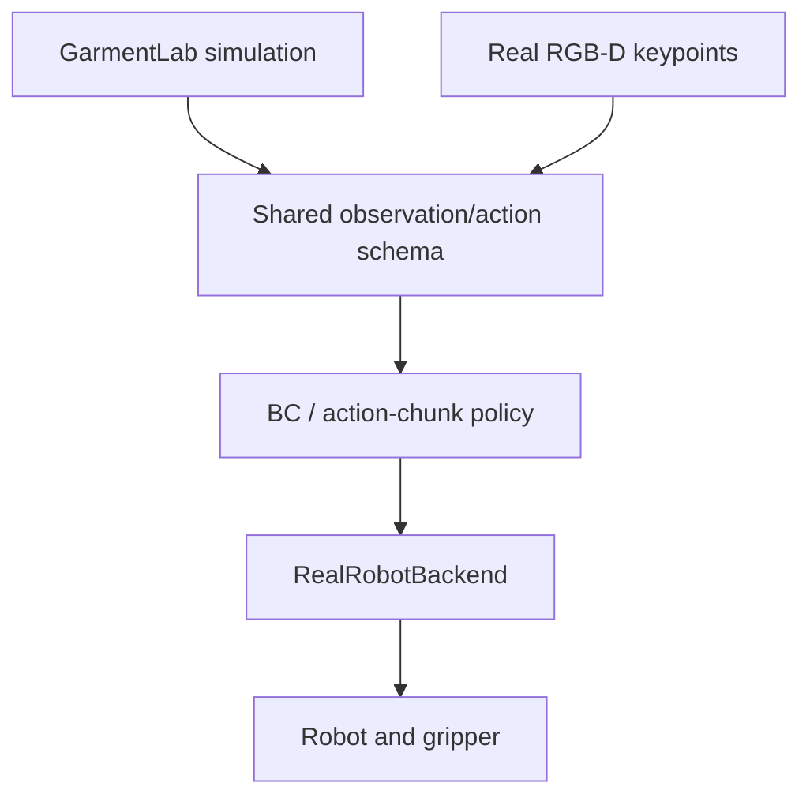

# Marian Frei  Demo：GarmentLab 2024 十阶段执行计划

> 项目名称：**Fast and Robust Garment Folding with Temporal Action Chunking**<br>
> 中文：**面向不同初始状态难度的快速鲁棒衣物折叠与动作分块**<br>
> 主 baseline：**GarmentLab — NeurIPS 2024**<br>
> 设备：联想小新 13 Pro 2020（Windows 10）+ AutoDL NVIDIA GPU 服务器<br>
> 推进方式：10 个阶段，按验收结果推进；每个阶段可跨多天<br>
> 最终交付：GitHub repo + 60–90 秒视频 + 核心实验图 + 2 页 mini report + Sim-to-Real 接口与路线图 + 联系 Marian 的邮件段落

---

> 命名约定：Stage 表示按验收推进的工作阶段，每个阶段可跨多天；原 Day N 对应 Stage N。为兼容既有入口，`DAY4_*.md`、脚本、结果目录和历史日报文件名保留。


## 0. 最终决定

不再使用 SoftGym 作为主 baseline。

本项目改用：

> **GarmentLab: A Unified Simulation and Benchmark for Garment Manipulation**<br>
> NeurIPS 2024<br>
> GitHub：<https://github.com/GarmentLab/GarmentLab>

选择 GarmentLab 的原因：

1. 研究对象直接是 garment manipulation，而不是通用 soft-body benchmark；
2. 原生提供 `FoldEnv` 和可运行的 `FoldDemo.py`；
3. 基于 NVIDIA Isaac Sim 4.0，物理、机器人、相机与渲染栈比 SoftGym/PyFlex 更新；
4. 仓库包含数据采集、训练、推理和 garment-learning baseline；
5. 研究主题与 Marian 的 cloth folding、困难初态、动作表示和速度问题高度对应；
6. 项目为 NeurIPS 2024 工作，仓库在 2025 年仍有更新。

本 demo 的研究问题冻结为：

> How do initial garment-state difficulty and temporal action representation affect folding success, recovery behavior, and inference cost?

中文：

> 当衣物初始状态由平整变为扰动和褶皱时，single-step policy 与 action-chunk policy 的成功率、恢复能力和推理开销如何变化？

---

## 1. 为什么不用其他候选项目

| 项目 | 时间/维护情况 | Cloth folding | 结论 |
|---|---|---:|---|
| **GarmentLab** | NeurIPS 2024；2025 有提交 | 原生 `FoldEnv`/`FoldDemo` | **主 baseline** |
| NVIDIA Warp | 持续活跃，包含 cloth/self-contact 示例 | 无完整机器人折叠任务 | **安装失败 fallback** |
| BEHAVIOR-1K / OmniGibson | 2026 仍频繁更新 | 有 cloth/folding 任务体系 | 太大、安装和资产过重 |
| ManiSkill 3 | RSS 2025；维护活跃 | 没有现成 garment folding task | 不选 |
| DaXBench | ICLR 2023；最近主要提交停在 2023 | 有 cloth/T-shirt folding | 依赖含旧 Gym/Brax/TF，不作为新主线 |
| SoftGym | 2020–2021 为主 | 有 ClothFold | 旧 PyFlex/CUDA，不再使用 |

如果 GarmentLab 在 AutoDL 无法运行，fallback 使用：

> NVIDIA Warp cloth/self-contact example + 自己实现虚拟双夹爪与折叠目标。

fallback 仍使用现代 CUDA/Warp，不回退 SoftGym。

---

## 2. Demo 的范围

### 2.1 要完成的内容

- 一个 garment folding 环境；
- 三档初始状态：Flat / Perturbed / Crumpled；
- scripted expert 生成 demonstrations；
- single-step behavior cloning；
- H=4 action-chunk behavior cloning；
- success、recovery、policy calls、latency 和 failure modes 对比；
- 可复现实验、GIF/视频、主结果图和 mini report。

### 2.2 本 demo 不是完整 VLA

第一版使用 simulator state 或 garment keypoints，不把视觉大模型和语言模型硬塞进阶段式项目。

固定语言指令只有：

```text
Fold the garment in half.
```

只有一个固定指令时，加入 language token 没有科学意义。因此 README 中把它描述为：

> a preliminary action-representation study for fast and robust garment-folding VLA policies

不要写成：

> a complete VLA model

### 2.3 本轮暂时不做，但必须预留接口

- OpenVLA、π0、OpenPI 全量训练；
- RGB 端到端 VLA；
- 真实机器人实机实验；
- ROS2 / MoveIt2 的设备驱动；
- 多种衣服与多种语言指令；
- 完整 ACT Transformer；
- RL fine-tuning；
- 完整 sim-to-real 实验。

本轮不要求连接真机，但代码从 Stage 3 起必须满足：

```text
同一个 policy
→ 同一种 observation/action schema
→ GarmentLabBackend 或 RealRobotBackend
```

禁止让 policy 直接依赖 Isaac Sim 的关节命令、USD 对象路径或粒子索引。仿真专用信息只允许存在于 demonstration expert 和 `GarmentLabBackend` 内。

---

## 3. 设备与 AutoDL 配置

### 3.1 本地—云端分工

| 设备 | 工作 |
|---|---|
| 联想小新 13 Pro 2020 | VS Code、Git、写代码、分析 CSV、画图、README、报告 |
| AutoDL | Isaac Sim、GarmentLab、数据生成、训练、正式 rollout、视频渲染 |
| GitHub | 代码、配置、结果图、小型 sample |
| AutoDL 数据盘 | Isaac Sim、assets、dataset、checkpoints、完整视频 |

本地不需要安装 Ubuntu，也不需要本地独立显卡。使用 VS Code Remote SSH 连接 AutoDL。

### 3.2 建议租用配置

GarmentLab/Isaac Sim 比原来的 SoftGym 方案更重。推荐：

```text
GPU: RTX 3090 24 GB（优先）
备选: RTX 4090 24 GB / A5000 24 GB
RAM: 32 GB 最低，64 GB 更稳
CPU: 8 vCPU 或以上
可用磁盘: 至少 120 GB，推荐 150–200 GB
系统: Ubuntu Linux
```

不建议：

- 8 GB 显存显卡；
- 系统盘/数据盘不足 100 GB；
- 为这个 demo 租 A100/A800 多卡实例；
- 在小新本地安装 Isaac Sim。

### 3.3 租用前检查

AutoDL 实例必须满足：

- NVIDIA GPU；
- Linux；
- 支持无头运行；
- 能使用 Vulkan/RTX 渲染或 Isaac Sim headless；
- 有足够磁盘安装 Isaac Sim 4.0 和 GarmentLab assets；
- 能通过 SSH 连接。

开机后记录：

```bash
nvidia-smi
nvcc --version
python --version
free -h
df -h
```

---

## 4. 从 GarmentLab 复用什么

固定上游仓库：

```text
GarmentLab/GarmentLab
```

开始时记录实际使用的 commit hash，不始终跟随 `main`。

### 4.1 直接复用

| GarmentLab 路径 | 用途 | 处理方式 |
|---|---|---|
| `demo/FoldDemo.py` | 官方 scripted folding 示例 | 改造成参数化 expert，不直接当最终成果 |
| `Env/env/FoldEnv.py` | 折叠环境 | 通过 wrapper 调用，尽量不直接修改 |
| `Env/env/BaseEnv.py` | 环境启动、step/reset | 原样复用 |
| `Env/env/Control.py` | Franka grasp/move/ungrasp | 原样复用或轻量封装 |
| `Env/Config/GarmentConfig.py` | garment asset 和物理参数 | 通过 YAML 配置化 |
| `Env/Camera/Recording_Camera.py` | 录制结果 | 复用 |
| `LearningBaseline/unigarmentmanip/collect/` | 数据采集结构参考 | 选择性复用 |
| `LearningBaseline/unigarmentmanip/train/` | 训练代码结构参考 | 不直接运行完整模型 |
| `LearningBaseline/unigarmentmanip/Inference/Fold.py` | folding inference 参考 | 只作接口参考 |
| `LearningBaseline/rl_fold/` | fold reward/evaluation 参考 | 只复用指标思想 |

### 4.2 自己必须实现

| 新模块 | 内容 |
|---|---|
| `envs/garmentlab_wrapper.py` | 统一 reset、seed、headless、state、step、record |
| `envs/difficulty.py` | Flat/Perturbed/Crumpled 生成协议 |
| `experts/fold_expert.py` | 参数化 pick-lift-transfer-place expert |
| `experts/recovery.py` | Perturbed/Crumpled 的最多两个 recovery moves |
| `data/generate_demos.py` | rollout 和 HDF5/NPZ 保存 |
| `data/dataset.py` | episode split、normalization、chunk slicing |
| `policies/bc_single.py` | 当前 observation → 下一动作 |
| `policies/bc_chunk.py` | 当前 observation → H=4 动作块 |
| `evaluation/metrics.py` | success、coverage/alignment、latency、failure type |
| `evaluation/evaluate.py` | paired seeds 正式实验 |
| `scripts/make_figures.py` | 主图、失败类型图、qualitative examples |
| `backends/base.py` | 定义仿真与真机共用的设备接口 |
| `backends/garmentlab_backend.py` | 把 GarmentLab 封装为统一 Backend |
| `schemas/observation.py` | 固定 RGB-D/关键点/机器人状态字段 |
| `schemas/action.py` | 固定机器人无关的笛卡尔 pick-place 动作 |
| `docs/sim2real_plan.md` | 标定、ROS2、真实数据微调与安全约束路线 |

不要复制整个 GarmentLab 再声称是自己的项目。README 必须有：

```text
Upstream code reused
Our additions
```

---

## 5. 冻结后的实验设计

### 5.1 任务

第一版只选择一件结构简单的 garment：

- 优先 scarf / towel / square garment；
- 如果官方 assets 中平面上衣更稳定，则使用单件 top；
- 任务固定为一次 half-fold；
- 使用一个 Franka 或虚拟双夹点；
- 每个 episode 最多 12 个 high-level actions。

不要第一版就做完整 T-shirt 多阶段折叠。

### 5.2 Observation

最低完成版：

```text
garment keypoints / sampled particle positions
+ gripper pose
+ grasp state
+ task phase
```

推荐维度：

```text
four corners xyz
garment center xyz
edge midpoints xyz
end-effector xyz
gripper state
phase one-hot
```

如果 garment 拓扑不能稳定提供四角，就使用固定数量 sampled particles 或 point-cloud keypoints。不要在第 4 天以后更换 observation 定义。

### 5.3 Action

一个 policy high-level action 使用机器人无关的笛卡尔 waypoint：

```text
[target_x, target_y, target_z, target_yaw, gripper_command]
```

若使用双夹点：

```text
[left_target_xyz_yaw, left_gripper_command,
 right_target_xyz_yaw, right_gripper_command]
```

其中 `gripper_command ∈ {open, close, hold}`。`GarmentLabBackend` 和未来的 `RealRobotBackend` 各自把 waypoint 转换为关节轨迹；policy 不输出关节角、速度或力矩。

动作阶段：

```text
approach → grasp → lift → transfer → place → release
```

### 5.4 三档初始状态

| 难度 | 定义 | 生成方法 |
|---|---|---|
| L1 Flat | 平整、只有小幅平移/旋转 | reset 后施加随机平移与 yaw |
| L2 Perturbed | 局部皱褶或一角偏移 | 随机角点轻度 lift-drop 后 settle |
| L3 Crumpled | 明显皱褶，直接折叠前需要恢复 | 1–2 次随机 grasp-lift-drop 后 settle |

配置写入：

```text
configs/difficulty.yaml
```

必须固定：

- 平移/旋转范围；
- lift height；
- drop position；
- physics settle steps；
- random seeds。

### 5.5 Scripted expert

从官方 `FoldDemo.py` 的 grasp/move/ungrasp 流程改造成参数化 expert。

L1：

```text
detect/source keypoints
→ grasp fold edge
→ lift
→ transfer across fold line
→ place
→ release
```

L2/L3：

```text
最多两个 recovery/spread moves
→ 再执行 half-fold
```

expert 可以使用 simulator state，但必须在报告中标记为：

> state-oracle expert used only for demonstration generation

### 5.6 两个 policy

#### Single-step BC

```text
observation_t → MLP → action_t
```

- 3 层 MLP；
- hidden size 256；
- continuous action 用 MSE；
- `open/close/hold` gripper command 用三分类 cross-entropy；
- 每一步重新推理。

#### Action-chunk BC

```text
observation_t → same MLP encoder → [action_t, ..., action_t+3]
```

- chunk horizon `H=4`；
- encoder、hidden size、数据、训练步数与 single-step 相同；
- 默认完整执行 4 步后重新推理；
- 记录 policy calls 与闭环误差。

这是 action-chunk BC，不是完整 ACT。不要在 README 写“ACT reproduction”。

### 5.7 数据量

最低交付：

```text
L1: 50 successful demonstrations
L2: 50 successful demonstrations
L3: 50 successful demonstrations
Total: 150
```

目标：

```text
L1/L2/L3: each 100
Total: 300
```

GarmentLab/Isaac Sim rollout 比简单 PyFlex 环境重，因此不再把 600 episodes 设为最低要求。

切分：

```text
70% train / 15% validation / 15% test
```

必须按 episode seed 切分，不能按 frame 切分。

### 5.8 指标

主指标：

```text
success rate
```

辅助指标：

```text
final alignment error
fold overlap / coverage
policy forward calls
median and P95 inference latency
trajectory length
recovery success rate
expert rejection rate
failure type distribution
```

失败类型：

```text
F1 missed grasp
F2 slip / premature release
F3 recovery failed
F4 incorrect fold line
F5 poor alignment
F6 timeout / unstable garment
```

正式实验：

```text
2 policies × 3 difficulty levels × 20 held-out seeds
= 120 evaluation episodes minimum
```

时间允许提高到每格 30 episodes。

### 5.9 从第一天冻结的 Sim-to-Real 接口

策略与设备执行必须解耦：

```python
obs = backend.get_observation()
action_chunk = policy.predict(obs)
result = backend.execute(action_chunk)
```

统一接口：

```python
class RobotBackend:
    def get_observation(self): ...
    def execute(self, action_chunk): ...
    def stop(self): ...
```

本轮实现 `GarmentLabBackend`；论文或实验室阶段再实现 `RealRobotBackend`。`reset()` 只属于仿真接口，真机复位初期由人工完成。

统一 observation schema：

```text
timestamp
rgb                       # 可选，但从 Stage 5 起保存
depth                     # 可选，但从 Stage 5 起保存
garment_keypoints         # 仿真真值或视觉估计值
end_effector_pose
gripper_state
task_phase
```

统一 action schema 使用桌面/机器人基坐标系下的笛卡尔 waypoint：

```yaml
target_pose: [x, y, z, yaw]
gripper_command: open | close | hold
phase: approach | grasp | lift | transfer | place | release
```

expert 可以使用 `execute_pick_place(pick_pose, place_pose, lift_height)` 便捷函数，但它必须在 Backend 内部展开为上述 waypoint 序列。Single-step 与 H=4 policy 始终预测统一 waypoint action。

禁止把 Isaac Sim joint command 当作 policy 输出。仿真后端与真机后端分别负责逆运动学、轨迹规划和底层控制。

### 5.10 两种 observation 模式

为兼顾阶段计划可执行性和真机迁移，保留两种明确模式：

| 模式 | 输入 | 本轮用途 | 真机意义 |
|---|---|---|---|
| `oracle_keypoints` | 仿真真值关键点 | 主实验，保证能按时完成 | 不能直接部署 |
| `vision_ready` | 与 RGB-D 同步保存的关键点和机器人状态 | 数据和接口预留 | 后续用视觉估计关键点替换真值 |

本轮主结果允许使用 `oracle_keypoints`，但 README 必须写清楚：

> Ground-truth garment keypoints are used for the preliminary simulation study; real-robot deployment requires RGB-D keypoint estimation and real-data fine-tuning.

---

## 6. Stage 1–Stage 10 具体执行

## Stage 1 — AutoDL、Isaac Sim 4.0 与 GarmentLab 安装

目标：完成小新到 AutoDL 的远程开发链路，并验证 Isaac Sim。

任务：

- 租 RTX 3090 24 GB、32/64 GB RAM、150 GB 左右磁盘的实例；
- 在小新配置 VS Code Remote SSH；
- 建立 GitHub repo；
- 记录 GPU/CUDA/内存/磁盘；
- 安装 Isaac Sim 4.0；
- 运行 Isaac Sim 官方 `add_cubes.py` headless/smoke test；
- 克隆 GarmentLab，记录 commit hash；
- 只下载运行 FoldDemo 所需的最小 assets，避免先下载全部 9000+ assets；
- 建立 `environment_log.md`。
- 在 `docs/sim2real_assumptions.md` 记录目标真机最小假设：单臂、平行夹爪、顶视 RGB-D、桌面方巾；机器人型号暂不硬编码。

验收：

```text
SSH works
→ Git pull/push works
→ Isaac Sim starts headlessly
→ add_cubes smoke test succeeds
```

Stage 1 不训练模型。

## Stage 2 — 跑通 GarmentLab FoldDemo，执行 Go/No-Go

目标：完成 `reset → grasp → move → release → video`。

任务：

- 修正 `FoldDemo.py` 中的硬编码绝对路径；
- 加载一件 garment asset；
- 运行 `FoldEnv`；
- 执行官方 grasp/move/ungrasp sequence；
- 保存 RGB 视频；
- 验证能够读取 garment state 和 end-effector state；
- 测试固定 3 个 seeds。

验收：

```text
3/3 episodes launch correctly
at least 2/3 finish the scripted fold
video is saved
state can be exported
```

Go/No-Go：

> 本阶段累计调试 6 小时仍无法完成 FoldDemo，就停止 GarmentLab 安装调试，Stage 3 切换 NVIDIA Warp fallback。

允许修复路径、headless 参数和 asset 路径；不要开始重写 Isaac Sim 或 GarmentLab 核心。

## Stage 3 — Wrapper 与可重复 reset

目标：把官方 demo 变成可编程实验环境。

任务：

- 实现 `backends/base.py` 和 `GarmentLabBackend`；
- 让 `garmentlab_wrapper.py` 只处理 GarmentLab 细节，不让 policy 直接访问 simulator API；
- 配置化 asset path，不保留 `/home/user/...`；
- 实现 `reset(seed, difficulty)`；
- 实现 observation extractor；
- 实现 high-level action wrapper；
- 将 high-level action 固定为笛卡尔 `pick_pose/place_pose/lift_height/gripper`；
- 为未来 `RealRobotBackend` 写一个不连接硬件的接口 stub；
- 实现 video on/off；
- 保存 environment metadata；
- 连续运行 10 次 reset/rollout。

验收：10 次运行没有路径错误、资源泄漏或数据保存错误；smoke policy 不修改代码即可在 mock backend 与 GarmentLab backend 间切换。

## Stage 4 — Difficulty protocol 与 expert

目标：三个难度可区分，scripted expert 可自动运行。

任务：

- 实现 Flat/Perturbed/Crumpled；
- 每档保存 10 个 initial-state screenshots；
- 参数化官方 FoldDemo；
- 加入最多两个 recovery moves；
- 定义 alignment、overlap 和 success threshold；
- 在正式训练前冻结 threshold；
- 记录 expert rejection rate。
- 检查 expert 使用的 simulator-only state 未泄漏进 policy action 或 Backend 公共接口。

验收：每档至少 5 个成功 expert episodes，且三档初态肉眼可区分。

## Stage 5 — 生成 demonstrations 与 Dataset

目标：得到第一版固定数据集。

任务：

- 先生成每档 50 条成功轨迹；
- 统计生成时间和 AutoDL 成本；
- 时间允许扩展到每档 100 条；
- 保存统一字段：timestamp、关键点、末端位姿、夹爪状态、action、phase、success；
- 条件允许时同步保存低分辨率 RGB-D，不能保存时至少保留相机内外参和帧时间戳；
- 按 episode seed 切分；
- 实现 normalization；
- 实现 single-step 与 H=4 chunk sample；
- 写 chunk alignment unit test；
- 输出 `dataset_summary.json`。

验收：至少 150 条成功 demonstrations；两个 policy 使用相同 episode 数据。

## Stage 6 — Single-step BC

目标：完成第一个 learned closed-loop policy。

任务：

- 实现三层 MLP；
- 先过拟合 10–20 条 trajectories；
- 检查 action scale、grasp BCE 和 phase labels；
- 训练完整数据；
- L1/L2/L3 各运行 5–10 个调试 episodes；
- 保存成功和失败视频。

验收：L1 success 明显超过 random policy，checkpoint 可重新加载。

## Stage 7 — H=4 Action-chunk BC

目标：比较 temporal action representation。

任务：

- 实现 chunk dataset 与 padding mask；
- 使用与 single-step 相同 encoder；
- 先过拟合小数据；
- 训练完整数据；
- 仿真主实验实现完整执行 chunk 后重新规划；
- 同时实现 `execute_k` 参数，使真机阶段可以“预测 H=4，只执行前 1–2 步再观察”；
- 记录 policy calls、median/P95 latency；
- 使用与 single-step 相同 GPU 测量。

验收：chunk indexing、gripper command 和 padding 均通过 unit test，能完成 L1 rollout。

## Stage 8 — 正式实验

目标：产生冻结后的主结果。

任务：

- 冻结 configs、checkpoint selection 和 test seeds；
- 先跑 2 个 seeds dry run；
- 每个 policy × difficulty 运行 20 个 episodes；
- 两个 policy 使用相同 seeds；
- 每完成一个 difficulty 增量保存 CSV；
- 自动保存 representative successes/failures；
- 输出 `raw_results.csv`。

验收：完整得到 `2 × 3 × 20` 结果矩阵。

不要因为 action chunk 表现差而重新选择 test seeds。

## Stage 9 — 分析、README、视频和 mini report

主要在小新本地完成，AutoDL 关机。

任务：

- success rate + bootstrap 95% CI 主图；
- policy calls / latency 图；
- failure distribution 图；
- 6 格 qualitative figure；
- 60–90 秒视频；
- README 第一屏；
- 2 页 mini report；
- 写 limitations。
- 绘制一张 `policy → shared schema → sim/real backend` 架构图；
- 在 mini report 加入一页以内的真机迁移路线与风险说明。

必须回答：

1. 初态更难时，两种 policy 如何退化？
2. action chunk 是否降低了 policy calls 和推理开销？
3. open-loop chunk 是否削弱了 crumpled state recovery？
4. 最常见失败来自 grasp、recovery 还是 alignment？

## Stage 10 — 干净复现与联系材料

任务：

- 从保存的 AutoDL 镜像或干净 shell 运行 smoke test；
- 一条命令重现单次 evaluation；
- 一条命令从 CSV 重建主图；
- 移除绝对路径、缓存和大文件；
- 固定 Isaac Sim/GarmentLab commit 和配置；
- 检查上游 license 与 citation；
- 下载最终 results、report 和 sample 到小新；
- 完成发给 Marian 的邮件；
- 练习 90 秒项目介绍。
- 检查 `RealRobotBackend` stub、统一 schema 和 `docs/sim2real_plan.md` 均已进入仓库；
- 准备询问 Marian：实验室的机械臂、夹爪、RGB-D 相机、ROS 版本和可用示教方式。

最终验收：陌生人只看 README 即可理解问题、修改内容、实验结果、真机迁移接口和下一步。

---

## 7. NVIDIA Warp fallback

只有 Stage 2 GarmentLab Go/No-Go 失败时才启用。

仓库：<https://github.com/NVIDIA/warp>

使用内容：

- cloth simulation example；
- cloth self-contact example；
- GPU simulation；
- USD/headless 输出。

自己添加：

- square cloth；
- two virtual grippers；
- grasp constraints；
- fold target；
- three difficulty generators；
- scripted expert；
- 同一套 BC/action-chunk/evaluation。

fallback 后的阶段安排：

```text
Stage 3: Warp cloth + grippers
Stage 4: difficulty + expert
Stage 5: dataset
Stage 6: single-step BC
Stage 7: chunk BC
Stage 8: evaluation
Stage 9–10: artifacts and application
```

报告必须说明：Warp fallback 是 simplified cloth benchmark，不等于 GarmentLab garment-robot benchmark。

---

## 8. Repo 结构

```text
garmentlab-action-chunk-demo/
├── README.md
├── LICENSE
├── environment.md
├── backends/
│   ├── base.py
│   ├── garmentlab_backend.py
│   ├── mock_backend.py
│   └── real_robot_backend_stub.py
├── schemas/
│   ├── observation.py
│   └── action.py
├── configs/
│   ├── garment.yaml
│   ├── difficulty.yaml
│   ├── bc_single.yaml
│   └── bc_chunk_h4.yaml
├── envs/
│   ├── garmentlab_wrapper.py
│   └── difficulty.py
├── experts/
│   ├── fold_expert.py
│   └── recovery.py
├── data/
│   ├── generate_demos.py
│   ├── dataset.py
│   └── dataset_summary.json
├── policies/
│   ├── common.py
│   ├── bc_single.py
│   └── bc_chunk.py
├── evaluation/
│   ├── evaluate.py
│   ├── metrics.py
│   └── failure_labels.py
├── tests/
│   ├── test_dataset_split.py
│   └── test_chunk_alignment.py
├── scripts/
│   ├── smoke_test.py
│   ├── run_eval.py
│   └── make_figures.py
├── results/
│   ├── raw_results.csv
│   ├── success_vs_difficulty.png
│   ├── latency_policy_calls.png
│   ├── failure_distribution.png
│   ├── qualitative_examples.png
│   └── demo.mp4
├── docs/
│   ├── mini_report.pdf
│   ├── sim2real_plan.md
│   └── sim2real_assumptions.md
└── third_party/
    └── README.md
```

GarmentLab 建议作为单独 clone 并固定 commit，或用 git submodule；不要把全部 assets 提交到自己的 GitHub。

---

## 9. 给 Marian 展示什么

### 9.1 README 第一屏

```text
Problem
How do initial garment-state difficulty and temporal action representation
affect folding robustness and inference cost?

Environment
GarmentLab / Isaac Sim 4.0; flat, perturbed, and crumpled initial garments.

Comparison
Single-step BC vs H=4 action-chunk BC.

Finding
[Only fill this after the real experiment.]
```

### 9.2 主图

```text
x-axis: Flat / Perturbed / Crumpled
y-axis: Success Rate
series: Single-step BC / Action-chunk BC
```

必须显示 episode 数和 95% confidence interval。

### 9.3 视频

```text
0–10 s: research question
10–25 s: three initial-state levels
25–50 s: two policies
50–70 s: success/failure examples
70–90 s: main result and thesis extension
```

### 9.4 邮件中的三句话

```text
Inspired by your advertised topic on fast and robust cloth-folding VLA policies,
I built a small preliminary benchmark on GarmentLab and Isaac Sim. I compared
single-step behavioral cloning with H=4 action-chunk prediction across flat,
perturbed, and crumpled garment states, measuring folding success, recovery
behavior, policy calls, and failure modes. This experiment made me particularly
interested in adaptive action horizons that reduce inference cost without losing
closed-loop recovery ability.
```

后面附 GitHub、视频和两页报告链接，并询问该题目是否可以缩小为 Bachelorarbeit scope。

### 9.5 同时展示真机衔接图



展示时必须主动说明：本轮 Demo 的结果是仿真结果，尚未声称完成真机验证；但 policy、数据和动作接口已经按后续真机迁移设计。

---

## 10. 从 Demo 衔接到真机的执行路线

### 10.1 推荐的第一项真机任务

第一项真机实验固定为：

```text
单机械臂 + 平行夹爪 + 顶视 RGB-D
方巾/毛巾
从 Flat 或轻度 Perturbed 状态完成一次 half-fold
```

暂不从双臂、完整 T-shirt 或严重 Crumpled 状态开始。这样可以先验证视觉、标定、抓取和 policy execution 四个核心环节。

### 10.2 真机软件栈

| 层 | 仿真阶段 | 真机阶段 |
|---|---|---|
| 观测 | 仿真关键点 + 可选 RGB-D | 顶视 RGB-D → 角点/边缘关键点 |
| 策略 | Single-step / H=4 BC | 同一 checkpoint 或真实数据微调后的 checkpoint |
| 动作 | 笛卡尔 waypoint + gripper command | 相同 action schema |
| 执行 | `GarmentLabBackend` | `RealRobotBackend` |
| 规划控制 | Isaac Sim controller | ROS2/MoveIt2 或厂商 SDK |
| 复位 | 自动 reset | 初期人工铺布 |

不要把 Isaac Sim 代码复制到机器人主机。真机只新增：

1. 相机驱动和时间同步；
2. 相机内参与手眼/桌面坐标标定；
3. RGB-D 关键点检测；
4. `RealRobotBackend`；
5. 机械臂轨迹规划与夹爪控制；
6. 安全限制和急停。

### 10.3 真实数据与微调

不把 zero-shot sim-to-real 设为硬目标。建议采集 30–100 条真机示教：

```text
仿真 demonstrations 预训练
→ 30–50 条真机演示完成第一轮微调
→ 真机 rollout 收集失败和人工纠正
→ 扩展到 50–100 条真实轨迹再次微调
```

示教可根据实验室设备选择：遥操作、拖动示教、键盘/SpaceMouse 控制或人工指定 pick/place 点。真实数据必须使用与仿真相同的 observation/action 字段。

### 10.4 Domain randomization

在 GarmentLab 中随机化：

- cloth 颜色、纹理、质量、刚度和摩擦；
- 桌面纹理与摩擦；
- 光照、相机位置和相机角度；
- 深度噪声和局部遮挡；
- 抓取点、末端位姿和释放时刻误差；
- 控制延迟和执行噪声。

随机范围应尽量由真实设备测量决定，不要无边界地扩大。

### 10.5 真机 Action Chunk 执行方式

仿真主实验可以完整执行 H=4；真机初期使用 receding horizon：

```python
while not done:
    obs = backend.get_observation()
    chunk = policy.predict(obs)   # 预测未来 4 个动作
    backend.execute(chunk[:1])    # 只执行第 1 个，再观察
```

稳定后再执行 `chunk[:2]`。抓取、接触、释放和失败恢复阶段保持短 horizon；自由空间移动可以使用较长 horizon。这正好衔接后续 adaptive action chunking 论文问题。

### 10.6 真机安全底线

- policy 只输出高层 waypoint，不输出力矩；
- 经典控制器负责逆运动学、碰撞检查和轨迹执行；
- 限制笛卡尔工作空间、速度、加速度和夹爪力；
- 每个 waypoint 执行前检查桌面高度和可达性；
- 首次测试使用低速模式并安排人工急停；
- 感知置信度过低、轨迹不可达或夹爪异常时立即停止；
- 先做离线回放和空载轨迹，再接触布料。

### 10.7 Demo 后八周计划

| 周次 | 任务 | 验收标准 |
|---|---|---|
| Week 1–2 | 在仿真中训练/接入 RGB-D 关键点检测，替换 oracle 输入 | 不读粒子真值也能完成 Flat 折叠 |
| Week 3 | 相机—桌面—机器人标定；手动笛卡尔抓放 | 指定桌面点可低速稳定抓取 |
| Week 4 | 采集 30–50 条真实示教 | 数据 schema 与仿真完全一致 |
| Week 5 | 训练 real-only BC baseline | 真机能重复完成简单 half-fold |
| Week 6 | sim-pretrain + real fine-tune | 与 real-only 使用相同测试初态比较 |
| Week 7 | domain randomization + receding-horizon chunk | 对位置、旋转和轻微褶皱更稳定 |
| Week 8 | 正式评估、失败分类与论文图表 | 冻结测试集并形成实验表格 |

### 10.8 真机论文实验矩阵

数据方案：

| 方法 | 仿真预训练 | Domain randomization | 真实微调 |
|---|---:|---:|---:|
| Real-only BC | 否 | 否 | 是 |
| Sim-pretrain + FT | 是 | 否 | 是 |
| Sim-pretrain + DR + FT | 是 | 是 | 是 |

动作方案：

```text
single-step
fixed H=4 chunk
receding-horizon / adaptive chunk
```

真机指标：成功率、抓取成功率、折叠边缘对齐误差、人工干预次数、任务时间、推理延迟以及扰动后的恢复成功率。

---

## 11. 最自然的本科论文扩展

建议向 Marian 提出的后续问题：

> Can adaptive action chunking use longer horizons during predictable garment motion and shorter horizons during grasping and recovery to improve speed without sacrificing robustness?

扩展顺序：

1. 固定 H=4 → adaptive horizon；
2. state/keypoint → RGB-D/point cloud；
3. 单一 half-fold → 多种语言指定 fold；
4. scripted demonstrations → human/teleoperation demonstrations；
5. simulation → real robot validation。

---

## 12. 完成 Checklist

- [ ] AutoDL 可通过 VS Code Remote SSH 使用
- [ ] Isaac Sim 4.0 headless smoke test 通过
- [ ] GarmentLab commit 已固定
- [ ] FoldDemo 可以运行并保存视频
- [ ] 所有绝对路径已配置化
- [ ] Flat/Perturbed/Crumpled 有明确数值定义
- [ ] expert 和 recovery move 可以自动运行
- [ ] 至少 150 条成功 demonstrations
- [ ] episode-level train/val/test split 正确
- [ ] single-step BC 可闭环 rollout
- [ ] H=4 action-chunk BC 可闭环 rollout
- [ ] policy 不直接调用 Isaac Sim API 或输出 simulator joint command
- [ ] `GarmentLabBackend` 与统一 observation/action schema 已实现
- [ ] `RealRobotBackend` stub 可以被导入并通过接口测试
- [ ] H=4 policy 支持 `execute_k=1/2/4`
- [ ] 数据包含 timestamp、末端位姿、夹爪状态、phase 和 success
- [ ] RGB-D 未保存时，限制和后续补充方案已写入 README
- [ ] 两种 policy 使用相同数据和 test seeds
- [ ] 每格至少 20 个正式 evaluation episodes
- [ ] success threshold 在正式实验前冻结
- [ ] latency 在相同 GPU 上测量
- [ ] 主图包含 95% CI 和样本数
- [ ] 至少三类真实失败被展示
- [ ] README 区分上游复用与自己的贡献
- [ ] 60–90 秒视频完成
- [ ] 两页 mini report 完成
- [ ] `docs/sim2real_plan.md` 和架构图完成
- [ ] 干净复现通过
- [ ] 邮件只引用真实实验结果

---

## 13. 参考项目

- GarmentLab：<https://github.com/GarmentLab/GarmentLab>
- NVIDIA Warp：<https://github.com/NVIDIA/warp>
- BEHAVIOR-1K：<https://github.com/StanfordVL/BEHAVIOR-1K>
- ManiSkill 3：<https://github.com/mani-skill/ManiSkill>
- DaXBench：<https://github.com/AdaCompNUS/DaXBench>
- GarmentLab RealWorld benchmark：<https://garmentlab.readthedocs.io/en/latest/tutorial/realworldbenchmark/index.html>
