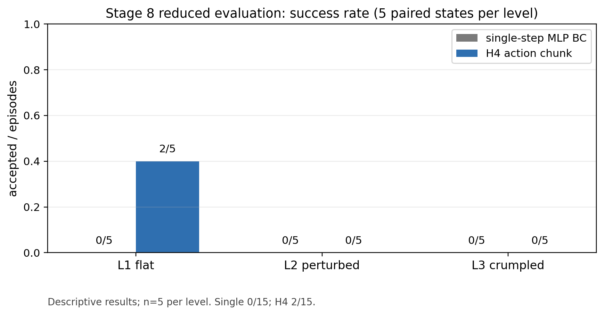
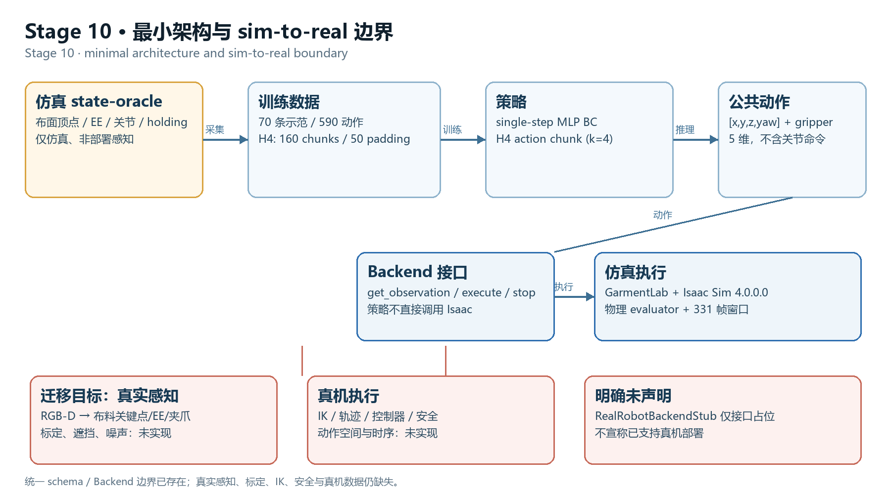
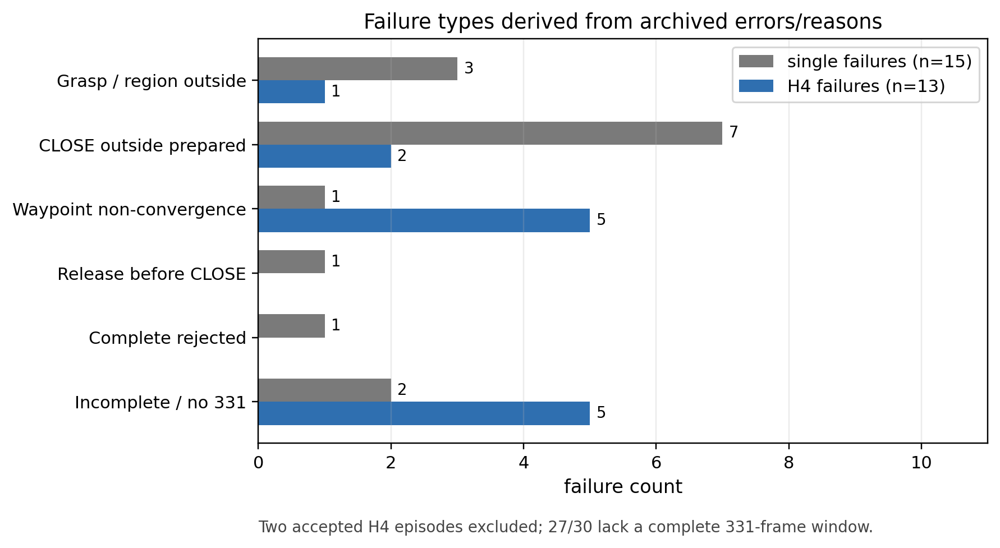

# GarmentLab Action Chunk Demo · v9.1.3

[English](#english) | [中文](#中文)

**Demo:** [60-second simulation showcase](https://github.com/zyyu1/garmentlab-action-chunk-demo/releases/download/v9.1.3/stage9_showcase_english.mp4) · [Release page](https://github.com/zyyu1/garmentlab-action-chunk-demo/releases/tag/v9.1.3)

720p · English-only captions · paired single-step BC / H4 simulation. Same 30 fps playback; not synchronized to simulation time or intended as a speed comparison.

## English

A reproducible, reduced-scale study of square-cloth folding in GarmentLab / Isaac Sim: **single-step MLP behavior cloning versus H4 action chunking**. This release packages the Stage 9 report and Stage 10 offline wrap-up with portable figure reproduction.

**Why this matters for the thesis:** The longer-term motivation is to understand how learned local manipulation policies could be integrated with task and motion planning for more complex robotic material-handling problems.

**Status:** 30 evaluation episodes completed; the full 120-episode evaluation and clean-environment simulation reproduction remain unfinished. Version 9.1.3 organizes existing evidence; it adds no simulation runs or training results.

### Results

| Initial-state level | Single-step BC | H4 chunk BC |
|---|---:|---:|
| L1 flat | 0/5 | **2/5** |
| L2 perturbed | 0/5 | 0/5 |
| L3 crumpled | 0/5 | 0/5 |
| **Total** | **0/15** | **2/15** |

15 paired seeds, 30 episodes; H4 succeeds on flat seeds 4111 and 4113. Stage 6/7 development runs are excluded from these denominators. These are descriptive small-sample results, without claims of statistical significance or generalization.



### Method and architecture

70 expert demonstrations (50/10/10 split; 590 actions) use simulation state-oracle observations. Policies receive a 1340-D observation and emit `[x, y, z, yaw] + gripper(0/1/2)`. H4 predicts four actions and uses `execute_k=4`. The models are MLP BC policies, not ACT Transformers. Single and H4 use 2000 and 500 training updates respectively, so this is not an equal-compute comparison.



### Report and evidence

- [Two-page Stage 9 report](reports/STAGE9_REPORT.pdf)
- [Stage 10 wrap-up](reports/STAGE10_WRAPUP.md)
- [Raw episode results](results/raw_results.csv), [archived summary with failure details](results/summary.json), and [reproduction checks](results/checks.json)
- [Environment and model identities](docs/ENVIRONMENT_IDENTITY.md)
- [Real-robot migration boundary](docs/MIGRATION.md)



### Reproduce the figures

From the repository root, with Python 3.10+:

```bash
python -m pip install matplotlib==3.10.1
python scripts/reproduce_figures.py
```

The script reads the packaged CSV and summary, validates 30 rows / 15 pairs, paired initial-state hashes, per-level denominators, success counts and failure classifications, then writes two PNGs, a figure-data CSV and `checks.json` into a new `figures_reproduced/` directory. Use `--out another_new_directory` for a repeat run. An existing output directory is deliberately rejected.

No GPU, Isaac Sim, model checkpoints or external project directories are needed for figure reproduction. Failure categories are derived from the archived summary because the CSV contains statuses but not error text. Figures use bundled Matplotlib fonts; v9.1.3 uses English chart labels, so historical PNGs need not be byte-identical. Original CSV and PDF are preserved.

### Rebuild the English demo video

The release video reuses the original simulation recordings and retains the 60-second sequence. All title cards and captions are English. The historical bilingual video remains available in the v9.1.0 Release.

With Pillow and FFmpeg installed, provide the original video directory and a TrueType font:

```bash
python scripts/build_demo_video.py --videos /path/to/original/videos --out /path/to/new/output --font /path/to/font.ttf
```

The five input filenames are listed in the script. Original recordings are external inputs, not bundled in this repository. Use `--ffmpeg /path/to/ffmpeg` if needed. No simulation is started.

### Scope and limitations

- L2/L3 both fail throughout; 27/30 episodes lack a complete 331-frame window. Missing geometry/stability is unavailable, not zero.
- Seeds 4110–4114, 4215 and 4313–4316 were previously used by Stage 4 experts; this is not a fully fresh independent test.
- The original 120-episode plan still has 90 unexecuted episodes. Expert and runner recovery settle/hold differences remain.
- The real-robot backend is an interface stub. Perception, calibration, IK/control and hardware safety are not implemented; no real-robot deployment is claimed.
- Simulation reproduction requires the historical environment, assets and checkpoints documented in the identity file. This release verifies offline figures only.
- The recorded GarmentLab checkout has no root LICENSE/CITATION file, and Isaac Sim is proprietary; no upstream redistribution rights are implied. This repository has no project license yet.

### Repository layout

```text
garmentlab-action-chunk-demo/
├── README.md
├── assets/
│   ├── architecture.png
│   ├── fig1_success_rate.png
│   └── fig2_failure_types.png
├── reports/
│   ├── STAGE9_REPORT.pdf
│   └── STAGE10_WRAPUP.md
├── results/
│   ├── raw_results.csv
│   ├── summary.json
│   └── checks.json
├── scripts/
│   ├── reproduce_figures.py
│   └── build_demo_video.py
└── docs/
    ├── ENVIRONMENT_IDENTITY.md
    └── MIGRATION.md
```

This is the showcase layout; existing source code and historical evidence remain in place. `summary.json` is included to make failure-type reproduction self-contained. The full 60-second MP4 is hosted as a GitHub Release asset; the optional GIF is omitted. Source entry points: [backends](backends/), [schemas](schemas/) and [experiment code](day4-actionchunk-test/).

## 中文

**演示视频：** [60 秒仿真展示](https://github.com/zyyu1/garmentlab-action-chunk-demo/releases/download/v9.1.3/stage9_showcase_english.mp4)（720p、纯英文字幕、single/H4 并排）。视频以相同 30 fps 播放，未按仿真时间同步，不用于比较执行速度。

本项目在 GarmentLab / Isaac Sim 中，以方形布料折叠为任务，比较 **single-step MLP 行为克隆与 H4 动作分块**。v9.1.3 整理 Stage 9 报告、Stage 10 离线收尾材料，并提供可独立运行的图表复现入口。

**与学位论文研究的关联：** 长期研究动机是探索如何将学习得到的局部操作策略与任务与运动规划相结合，以应对更复杂的机器人物料搬运与处理问题。

**状态：** 已完成缩减版 30 例评估；完整 120 例评估和干净环境仿真复现尚未完成。本版本整理已有证据，没有新增仿真或训练结果。

### 结果

| 初态档位 | 单步 BC | H4 动作分块 BC |
|---|---:|---:|
| L1 平整 | 0/5 | **2/5** |
| L2 扰动 | 0/5 | 0/5 |
| L3 揉皱 | 0/5 | 0/5 |
| **合计** | **0/15** | **2/15** |

共 15 个配对 seed、30 个 episode；H4 成功例为 L1 的 4111 和 4113。Stage 6/7 开发试跑不并入分母。这是小样本描述性结果，不宣称统计显著或泛化能力。


### 方法与架构

专家通过仿真 state-oracle 生成 70 条示范（50/10/10 划分、590 个动作）。策略输入 1340 维观测，输出 `[x, y, z, yaw] + gripper(0/1/2)`。H4 每次预测四个动作，固定 `execute_k=4`。模型为 MLP BC，不是 ACT Transformer。single 与 H4 的训练更新数分别为 2000 和 500，不属于相同计算预算对照。


### 报告与证据

- [Stage 9 两页报告](reports/STAGE9_REPORT.pdf)
- [Stage 10 收尾报告](reports/STAGE10_WRAPUP.md)
- [原始逐例结果](results/raw_results.csv)、[含失败详情的归档汇总](results/summary.json)、[复现校验](results/checks.json)
- [环境与模型身份](docs/ENVIRONMENT_IDENTITY.md)
- [真机迁移边界](docs/MIGRATION.md)


### 图表复现

在仓库根目录使用 Python 3.10+：

```bash
python -m pip install matplotlib==3.10.1
python scripts/reproduce_figures.py
```

脚本从仓库内的 CSV 和 summary 读取证据，校验 30 行、15 对初态、配对初态哈希、各档分母、成功数及失败分类，将两张 PNG、图表数据 CSV 和 `checks.json` 写入新目录 `figures_reproduced/`。重复运行请指定 `--out another_new_directory`，已有输出目录会被拒绝以避免覆盖。

复现图表不需要 GPU、Isaac Sim、模型 checkpoint 或仓库外目录。CSV 不含错误详情，因此失败类别从归档 summary 逐例推导。脚本使用 Matplotlib 自带字体；v9.1.3 图中文字采用英文，不要求与历史 PNG 逐字节相同。原始 CSV 和 PDF 保持不变。

### 重建纯英文视频

v9.1.3 沿用原始仿真录像及 60 秒片段顺序，片头、片尾和全部字幕均改为英文。历史双语视频仍保留在 v9.1.0 Release。

安装 Pillow 和 FFmpeg 后，按英文部分命令运行 `scripts/build_demo_video.py`，提供原始录像目录、全新输出目录及 TrueType 字体路径。脚本列明五个输入文件名；原始录像属于外部输入，未打包进仓库。此过程不启动仿真。

### 范围与限制

- L2/L3 全部失败；27/30 无完整 331 帧窗口，缺失几何/稳定性指标按不可用处理，不补零。
- 4110–4114、4215、4313–4316 曾用于 Stage 4 专家，不属于全新独立测试集。
- 原 120 例计划仍有 90 例未运行；专家与 runner 的 recovery settle/hold 差异仍存在。
- 真机 Backend 仅接口占位；感知、标定、IK/控制和硬件安全尚未实现，不宣称真机部署。
- 仿真复现仍依赖环境身份文件所列的历史环境、资产和 checkpoint。本版本仅验证离线图表复现。
- 记录中的 GarmentLab checkout 根目录缺少 LICENSE/CITATION，Isaac Sim 为专有软件；本项目尚无项目许可证，不代表已取得上游再分发授权。

### 目录说明

展示目录见上方完整目录树。保留既有源码及历史证据；额外收录 `results/summary.json`，使失败分类可独立复现。完整 60 秒 MP4 托管于 GitHub Release；可选 GIF 本次未收录。源码入口：[Backend](backends/)、[schema](schemas/)、[实验代码](day4-actionchunk-test/)。
