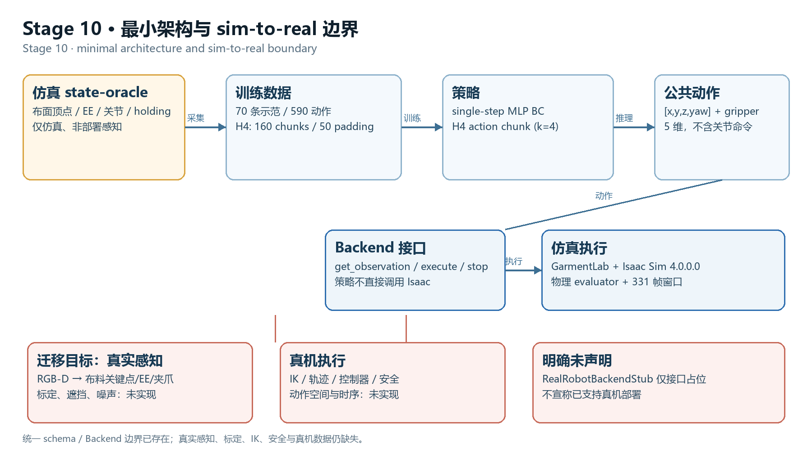

# 最小架构与迁移说明 / Minimal architecture and migration

## 中文

**当前边界。** 专家在仿真中使用 state-oracle（布面顶点、EE、关节、holding）生成 70 条示范；
训练得到 single-step MLP BC 与 H4 action chunk。策略只输出 5 维公共动作
`[x,y,z,yaw]+gripper(0/1/2)`，通过 `RobotBackend` 的
`get_observation / execute / stop` 进入 GarmentLab/Isaac Sim。公共 schema 和 Backend 边界已存在；
`RealRobotBackendStub` 是接口占位，所有设备方法 `NotImplementedError`。

**迁移时必须替换的部分。** 真实感知需要用 RGB-D 重建/跟踪布料关键点或稠密对应、估计 EE 位姿与
夹爪状态，再组装成同一 1340 维观测；而不是直接读取仿真顶点。还需要相机内参/手眼标定、
遮挡与噪声处理、初始化/重置和失败恢复策略。动作侧需要把 Cartesian waypoint 通过 IK 变成
关节轨迹，处理时序、夹爪延迟、碰撞/工作空间/力与急停；这些都没有实现。

**明确不声明。** 本工作没有真机驱动、没有真机标定、没有真机数据，也没有安全认证；
不能称为已支持真机部署。

## English

**Current boundary.** The expert uses a simulation state oracle (cloth vertices, EE,
joints, holding) to generate 70 demonstrations; the trained policies are a single-step
MLP BC and an H4 action-chunk policy. The policy emits only the 5-D public action
`[x,y,z,yaw]+gripper(0/1/2)` through the `RobotBackend` interface
(`get_observation / execute / stop`) into GarmentLab/Isaac Sim. The public schema and
Backend boundary exist; `RealRobotBackendStub` is interface-only and raises
`NotImplementedError` for every device method.

**What must change for real deployment.** Real perception must reconstruct/track cloth
keypoints or dense correspondences from RGB-D, estimate EE pose and gripper state, and
assemble the same 1340-D observation instead of reading simulator vertices. It also
needs camera intrinsics/hand-eye calibration, occlusion/noise handling, initialization,
reset, and recovery. On the action side, Cartesian waypoints must go through IK,
trajectory generation and a controller, with timing, gripper latency, collision,
workspace, force and emergency-stop constraints. None of these are implemented.

**Explicit non-claim.** There is no real-robot driver, calibration, real data, or safety
certification in this work; it is not a real-robot deployment.
